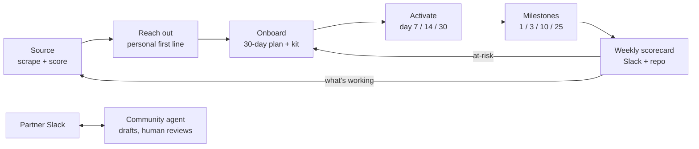

# Blotato Partnerships AI Engineer: Brandon Rose

> An application built as a working repo, because the job is building AI systems in GitHub, with skills, scheduled tasks, MCP and scraping.

**Live portfolio (tailored to this role):** https://brandonrose2.github.io/blotato-partnerships/
**My answers to the 4 questions:** [docs/answers.md](docs/answers.md)
**Contact:** ai@brandon-rose.com · (323) 533-0117 · [LinkedIn](https://www.linkedin.com/in/brandon-rose-ai/)

---

## What's in here

```
.
├── index.html                      # Portfolio carousel, ranked by relevance to the Partners program (GitHub Pages)
├── docs/answers.md                 # 1,000 partners / 10,000 partners / 3-month system / proudest accomplishment
├── partner-engine/
│   ├── source_partners.py          # Scrape and score creators/agencies (YouTube Data API or any scraped CSV)
│   ├── scorecard.py                # Weekly leaderboard, milestones, at-risk list, Slack message
│   ├── milestones.json             # Tiers: 1 / 3 / 10 / 25 paid referrals a month, plus rewards
│   ├── data/                       # Synthetic sample data (no real partners)
│   └── out/                        # Generated reports
├── .claude/skills/
│   ├── partner-sourcing/           # Claude Code skill: weekly prospecting run
│   ├── partner-onboarding/         # Claude Code skill: first 10 referrals in 30 days
│   └── slack-community-answers/    # Claude Code skill: triage the partner Slack
├── .mcp.json                       # Blotato MCP + Slack MCP for Claude Code (OAuth, no keys in the repo)
└── .github/workflows/
    └── weekly-partner-scorecard.yml  # Scheduled task: Mondays 8:07am PT, posts to Slack, commits history
```

## How the Partner Engine works



## Run it

```bash
cd partner-engine
python source_partners.py                                # score the sample candidates
python scorecard.py --month 2026-11 --today 2026-11-22   # build the sample scorecard
# live YouTube sourcing:
YOUTUBE_API_KEY=... python source_partners.py --youtube "n8n social media automation" "faceless youtube workflow"
```

Standard library Python only, so there's nothing to install. In Claude Code, the skills in `.claude/skills/` load automatically, and `/mcp` connects Blotato and Slack.

Sample output from `scorecard.py` on the sample data:

```
53 paid referrals - $3,152 first-payment revenue - 2/8 partners at the 10/month target
New milestones: Maya builds with AI -> Elite, Northside Growth Agency -> Core, ...
At risk: Creator Ops Weekly (25 days), Pixel & Post Studio (33 days)
```

## About me

I was hired as an executive assistant at a property management company and taught myself to build with AI. Between February and November 2026 I shipped 20+ tools: dashboards, scheduled reports, onboarding and certification portals, data collectors and scrapers. I use Claude Code daily. I also run my own scheduled jobs-finder pipeline, a local LLM setup, and shared tools I've built for friends who are growing creator accounts.
